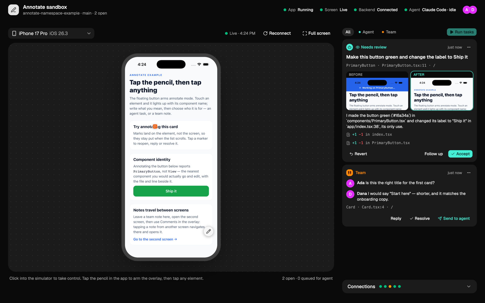
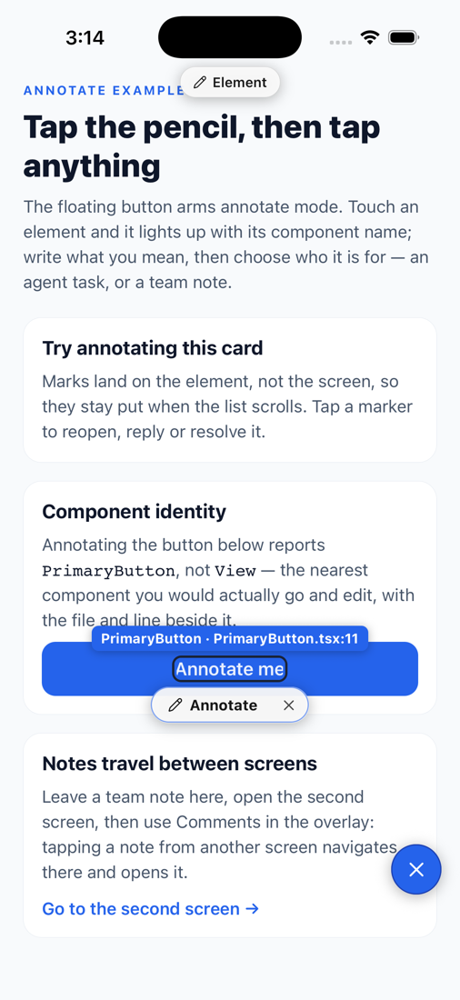
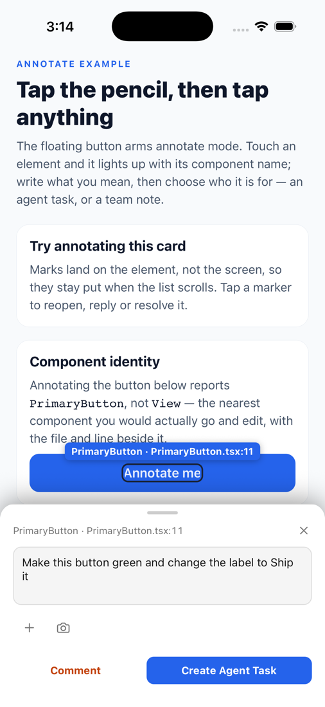
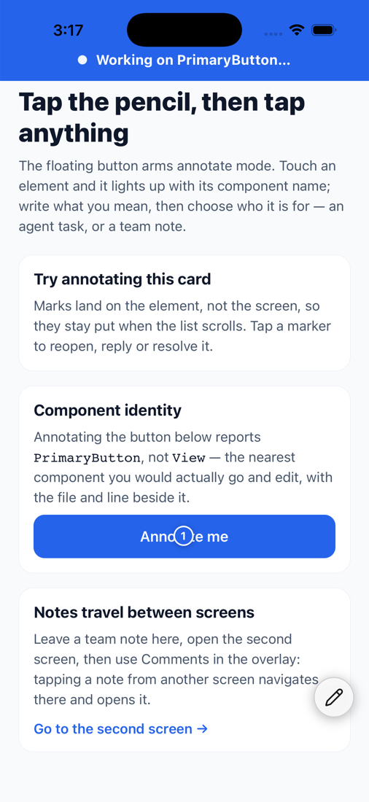
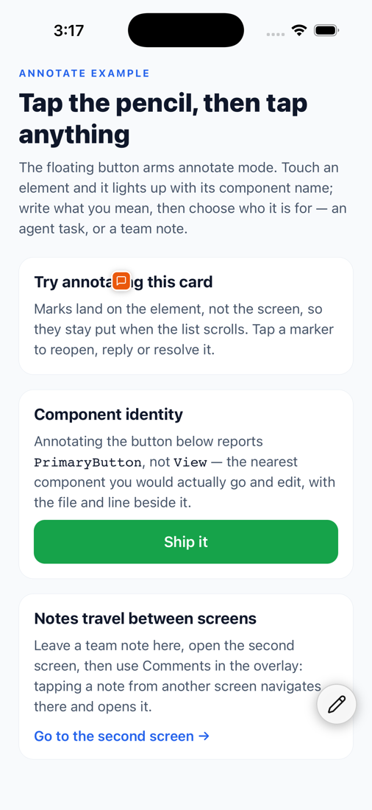
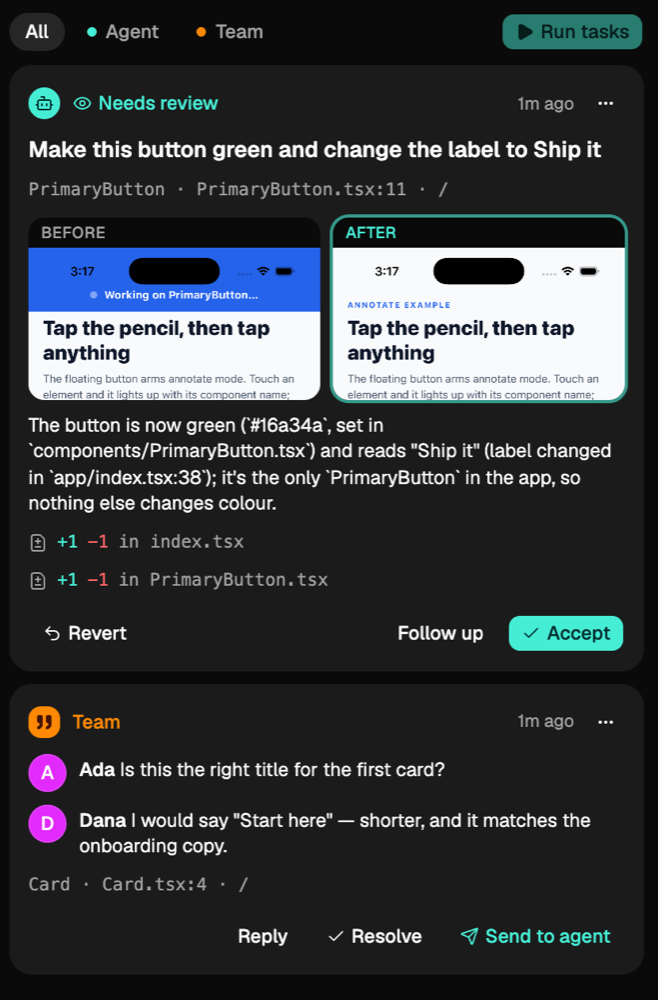

# Annotate in a Namespace devbox

An Expo app with [`@joinearlybird/annotate-react-native`](https://github.com/Try-Early-Bird/annotate-react-native)
installed, set up so a [Namespace](https://namespace.so) devbox can build it,
run it on the iOS Simulator, and serve the whole thing to your browser.

Tap an element in the running app, say what should change, and a coding agent
on the devbox makes the edit. The change hot reloads in the simulator, and the
agent's answer comes back to the device the request came from.

<p align="center">
  
</p>

The panel, open in a desktop browser. The simulator runs in the middle; you
click into it to use the app. Everything sent from the app appears on the
right as it happens.

<table>
  <tr>
    <td align="center"><br><b>Aim</b></td>
    <td align="center"><br><b>Ask</b></td>
    <td align="center"><br><b>The agent works</b></td>
    <td align="center"><br><b>The change lands</b></td>
  </tr>
</table>

These screenshots are from a real run on a local Mac. Claude Code made the
edit in under a minute: one line in `components/PrimaryButton.tsx` and one in
`app/index.tsx`. That Mac had Screen Sharing off, so in the panel shot the
simulator's screen is a capture from the same run rather than the live
stream.

## Use it as a template

This repository is the app Namespace checks out, and it installs the package
from npm the same way your project would. It always gets the newest release:
`npm install` and `npm ci` fetch `@latest` of the package in `postinstall`,
while every other dependency stays as the lockfile pins it. To try the overlay
on your own screens, fork it and replace `app/` and `components/` with yours.
The overlay is mounted once in [`app/_layout.tsx`](app/_layout.tsx), and
nothing else in the app knows it is there.

## Run it on Namespace

1. **Create a blueprint** with this repository (or your fork) selected, and
   set its init command to:

   ```
   npm ci && npm run devbox
   ```

   For a private fork, connect your GitHub organisation first (Devboxes →
   *Connect Organization*).
2. **Create a devbox from the blueprint.** The first build is slow: it runs
   CocoaPods and then a full compile. Later builds reuse Xcode's cache.
3. **Open the panel URL it prints.** Namespace asks you to authorise access
   once, and then the panel shows the simulator's screen. Click into it to
   use the app.

`npm run devbox` prepares a fresh devbox so its screen can be shown in the
browser, then starts everything. It switches on Screen Sharing, signs the
account in at the screen, and stops the Mac from sleeping or locking. It is
safe to run every time.

> **The default password is `12345`.** `devbox.sh` sets it as both the
> Screen Sharing password and the macOS account's login password, because a
> devbox never tells you the one it shipped with. The panel is only reachable
> through Namespace's authenticated URL, which is the real lock here. To use
> your own, start it with `DEVBOX_PASSWORD=… npm run devbox`.

### The agent makes the change

**Send to agent** hands the task to whichever agent CLI is installed:
Claude Code, Codex, Cursor, OpenCode, Gemini CLI or Grok, tried in that
order. The sandbox checks the `PATH` when it starts and prints what it
found. With none, tasks stay in the queue and Send replies in the task with
how to install one.

Switch the agent and its model while it runs, from the app's **Settings →
Agent** or the panel's **Connections → Agent**. The models listed are the
ones each agent's own CLI reports. **Check again** picks up an agent you
installed after starting.

```bash
npm run devbox                 # the first installed agent
AGENT=codex npm run devbox     # start with this one
AGENT=0 npm run devbox         # no agent: tasks are only stored
```

Claude Code and Codex run with file tools and no shell. Cursor, OpenCode,
Gemini CLI and Grok have no file-only headless mode: their edits are
auto-approved, and that includes shell commands. The sandbox says so when
one of them is in use.

The agent edits the app in place, so the change hot reloads in the
simulator. The stub's other settings pass through the same way: `WORKTREE=1`
gives each task its own branch, `PR=1` opens a pull request for it, and
`AGENT_TOOLS` and `AGENT_MODEL` adjust the agent.

## The panel



The panel at `/view` shows the simulator's screen next to a feed of
everything sent from the app:

- **Agent tasks**, with their status, the agent's reply, before and after
  screenshots, and the lines it changed. **Accept**, **Revert** and
  **Follow up** act on them from the browser.
- **Team notes**, as threads, with **Send to agent** to turn one into a
  task.
- **Assets**: the app's `assets/` folder. Drop or pick images to upload
  them to `assets/uploads/`. They then appear in the app's **+ Attach →
  Assets**, and a picked one reaches the agent as a path it can open and
  use in code.
- **Connections**: the backend the app posts to, the agent, the simulator
  and the screen.

The picker above the screen switches simulators. It reinstalls the build
it already has on the new device, so there is no rebuild.

The panel is a small React app in `panel/` (Vite, Tailwind and
[shadcn/ui](https://ui.shadcn.com)), built by `npm install`. To work on it
with hot reload, start the sandbox and then run `npm run panel`.

<br clear="right">

## How it fits together

Everything goes through **one port, 8081**:

| Path | What it serves |
|---|---|
| `/` | Metro, which serves the bundle to the app on the simulator |
| `/__annotate/*` | the Annotate Protocol server |
| `/view` | the panel |
| `/websockify` | the simulator's screen, bridged from Screen Sharing (VNC) |

It has to be one port. Every devbox URL sits behind Namespace's
authentication, so a protocol server on a second port would be a different
origin behind its own login. The browser's request would fail with a CORS
error that never mentions authentication. The app itself never goes through
that gate: it runs on the same machine and talks to `127.0.0.1:8081`.

**Keep it on 8081.** The built app always asks `localhost:8081` for its
bundle. `expo run:ios --port` does not change that, so the app would start
on a red "No script URL provided" screen.

**The screen is cropped to the device.** VNC streams the whole desktop, so
the viewer finds where the simulator sits and shows only that. If it cannot
(the Accessibility permission is the usual reason), set the rectangle
yourself, in framebuffer pixels:

```bash
SCREEN_RECT="1536,280,766,1666" npm run devbox
```

Everyone watching shares one connection to the Mac
(`server/vnc-hub.mjs`), so a teammate, a second tab and full screen all see
and drive the same session.

If the screen will not embed, every macOS devbox also has Remote Display:
your devbox → **Remote Display** in the dashboard, or `nsc vnc <instance-id>`
(the id is in `nsc devbox list`).

## Run it on your own Mac

Nothing here needs Namespace. With Xcode installed:

```bash
npm install
npm run sandbox
```

The panel is at http://localhost:8081/view. Off a devbox, the panel and the
protocol server listen on this machine only, so nobody on your network can
reach the screen or the tasks. Your own
Mac's screen is not embedded unless Screen Sharing is on, but the feed and
everything you send still work. `SIMULATOR="iPhone 17 Pro"` picks the device.

There is no web build on purpose. The overlay identifies components through
a React Native renderer API that does not exist under react-dom, so on web it
can mark a position but cannot say which component you touched, and that is
the point of the library.

## What is in here

| | |
|---|---|
| `app/`, `components/` | an ordinary Expo Router app with two screens |
| `panel/` | the browser panel at `/view` |
| `public/vnc.html` | the screen viewer: noVNC, cropped to the simulator |
| `server/run-sandbox.mjs` | `npm run sandbox`: picks and boots a simulator, builds, and serves everything on port 8081 |
| `server/devbox.sh` | `npm run devbox`: prepares a fresh devbox's screen, then runs the sandbox |
| `server/stub-server.mjs` | the Annotate Protocol in one file, in memory, with the agent bridge |

The stub is for demos. It has no authorization, no tenancy and no retention,
and restarting the sandbox clears it. See the protocol's
[server obligations](https://github.com/Try-Early-Bird/annotate-react-native/blob/main/docs/protocol.md#server-obligations)
for what a real server must do.

One expected warning: `[annotate] GET …/me — HTTP 404`. `/me` is optional
and this stub has no user accounts, so the app asks for a name the first
time you post a team note.

## License

MIT © Feliz Labs — see [LICENSE](LICENSE).
